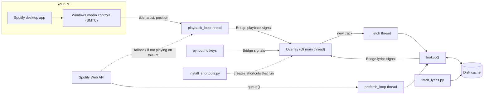
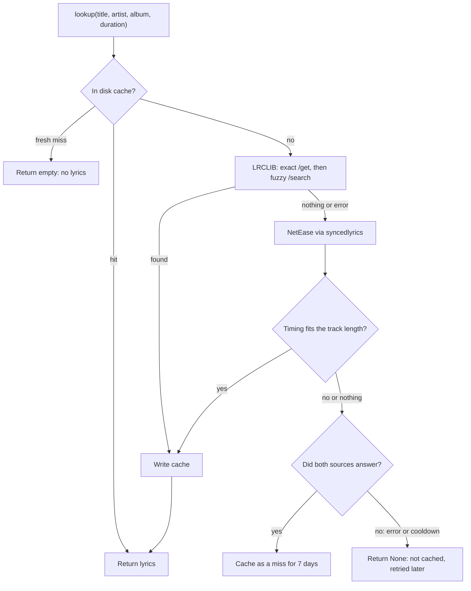

# Spotify Lyrics Overlay

A small Windows overlay that shows **time-synced lyrics for whatever Spotify is playing**, floating over your other windows. It slides smoothly from line to line, lets clicks pass straight through to the apps underneath, and keeps working when your internet drops.

It comes with three scripts:

| File | What it is |
|---|---|
| [`lyrics_overlay.py`](#lyrics_overlaypy) | The overlay itself. Detects what Spotify is playing, finds the lyrics, and displays them. |
| [`fetch_lyrics.py`](#fetch_lyricspy) | An optional batch tool. Downloads lyrics for a whole playlist or library in one go, so they are already on disk. |
| [`install_shortcuts.py`](#install_shortcutspy) | A one-time helper. Creates a Desktop shortcut (and optionally a start-at-login entry) so you never need a terminal. |

## Contents

- [Features](#features)
- [Requirements](#requirements)
- [Setup guide](#setup-guide)
- [Using it](#using-it)
- [Configuration](#configuration)
- [Troubleshooting](#troubleshooting)
- [How it works](#how-it-works)
- [Files the program creates](#files-the-program-creates)
- [Privacy, security and legal notes](#privacy-security-and-legal-notes)
- [Credits](#credits)

---

## Features

- **Synced lyrics** that follow the song and glide upward instead of jumping.
- **Click-through display.** Locked mode is display-only, so it never gets in the way of what is underneath.
- **Edit mode** (`Ctrl+Alt+L`): drag to move, drag the edges to resize, then set background opacity, lyric colour, lyric text size, title text size, and whether to show the track title and artist.
- **Auto show and hide.** Appears when Spotify starts playing, hides after 15 seconds without playback. Runs quietly in the system tray.
- **Offline-tolerant.** Lyrics are cached on disk. Playback is read locally from Windows (no internet needed), and upcoming queue tracks are pre-cached while you are online.
- **Multiple lyric sources.** Tries the disk cache first, then [LRCLIB](https://lrclib.net), then NetEase Cloud Music.
- **Bulk pre-download** of lyrics for a whole Spotify library via `fetch_lyrics.py`.

## Requirements

- **Windows 10 or 11.** The click-through window and local playback detection use Windows APIs.
- **Python 3.12** (what it was developed on) with `pip`.
- **The Spotify desktop app** for fully offline playback tracking. Playing on a phone or another device also works, but needs internet and the Spotify API (see below).
- **A free Spotify developer app** (client ID and secret), used for the web API fallback and queue pre-caching.

---

## Setup guide

### 1. Get the code

```powershell
git clone https://github.com/matildalyonne/lyricaloverlay.git
cd lyricaloverlay
```

Or download the three `.py` files into one folder.

### 2. Install the dependencies

```powershell
pip install PyQt6 spotipy pynput requests syncedlyrics
pip install winrt-runtime winrt-Windows.Media.Control winrt-Windows.Foundation winrt-Windows.Foundation.Collections winrt-Windows.Storage.Streams
```

The second line is what lets the overlay read Spotify's playback info locally from Windows. If those package names fail to install, try `pip install winsdk` instead. The code tries both.

### 3. Create a Spotify developer app

1. Go to the [Spotify Developer Dashboard](https://developer.spotify.com/dashboard) and create an app.
2. Under **Redirect URIs**, add exactly: `http://127.0.0.1:8888/callback`
3. Copy the **Client ID** and **Client Secret**.
4. Open `lyrics_overlay.py` and paste them into the config block near the top:

   ```python
   CLIENT_ID = "your-client-id"
   CLIENT_SECRET = "your-client-secret"
   ```

> **Never commit your real client secret to GitHub.** Keep the placeholders in the repository, or load them from environment variables. See [Privacy, security and legal notes](#privacy-security-and-legal-notes).

### 4. First run (from a terminal)

```powershell
python lyrics_overlay.py
```

Your browser opens for a one-time Spotify login. Approve it. Then play something in the Spotify desktop app. The overlay should appear within a second or two, and a green ♪ icon appears in your system tray (it may be tucked under the `^` arrow).

Run it from a terminal this first time so you can see any errors and login prompts. Later launches can use the shortcut.

### 5. Position and style the overlay

Press **`Ctrl+Alt+L`** to enter edit mode. Drag to move, drag the edges to resize, and use the controls at the bottom to set colour, sizes and opacity. Press `Ctrl+Alt+L` again to lock it. Edit mode also locks itself after 10 seconds without interaction, and your layout is saved.

### 6. (Optional) Pre-download lyrics for your whole library

1. Export your playlist or Liked Songs to CSV with [Exportify](https://exportify.net).
2. Rename the CSV to playlist.csv, put it in the project folder, then run:

   ```powershell
   python fetch_lyrics.py playlist.csv
   ```

You can also pass a plain text file with one `Artist - Title` per line. Re-running is safe: finished songs are skipped, and failures are retried.

### 7. (Optional) Add a Desktop shortcut and auto-start

```powershell
python install_shortcuts.py
```

It creates a **Lyrics Overlay** shortcut on your Desktop and asks whether to also start at login. The shortcut runs through `pythonw.exe`, so no terminal window opens.

---

## Using it

| Action | How |
|---|---|
| Toggle edit mode | `Ctrl+Alt+L` or tray menu → *Edit mode* |
| Quit | `Ctrl+Alt+Q` or tray menu → *Quit* |
| Bring the overlay up manually | Click the Desktop shortcut again, or tray menu → *Show overlay* |
| Move / resize | Edit mode: drag the body to move, drag an edge or corner to resize |

**Auto behaviour:** the program keeps running in the background. The overlay shows when playback starts and hides after `AUTO_HIDE_SECONDS` (15) of no playback. Pausing for less than that keeps it visible. Launching the program a second time does not open a second copy. It just tells the running copy to show itself.

---

## Configuration

Constants live in the config block at the top of `lyrics_overlay.py`.

| Constant | Default | Meaning |
|---|---|---|
| `LYRIC_OFFSET` | `0.0` | Seconds. Positive shows lyrics earlier, negative later. Use this if the lyrics drift slightly. |
| `AUTO_HIDE_SECONDS` | `15` | Hide the overlay after this long with no playback. |
| `AUTO_LOCK_SECONDS` | `10` | Edit mode locks itself after this long without interaction. |
| `SCROLL_SMOOTHING` | `0.12` | Seconds. Smaller means a snappier slide, larger means softer. |
| `BG_ALPHA` | `130` | Default background opacity (0–255) when locked. |
| `PREFETCH_COUNT` | `8` | How many upcoming queue tracks to cache ahead of time. |
| `PREFETCH_EVERY` | `30` | Seconds between queue checks. |
| `MISS_RETRY_DAYS` | `7` | Retry "no lyrics found" results after this many days. |
| `LRCLIB_COOLDOWN` | `300` | Seconds to skip LRCLIB after it fails. |
| `TIMEOUT` | `(10, 25)` | `(connect, read)` timeout in seconds for LRCLIB requests. |
| `CACHE_DIR` | `~/.lyrics_overlay_cache` | Where lyrics are cached. **Must match `CACHE` in `fetch_lyrics.py`.** |
| `HOTKEY_EDIT` / `HOTKEY_QUIT` | `Ctrl+Alt+L` / `Ctrl+Alt+Q` | Global hotkeys (pynput syntax). |
| `FONT_FAMILY` | `Segoe UI` | Display font. |
| `SWATCHES` | 7 colours | Colour choices shown in edit mode. |

Colour, text sizes, opacity, title visibility and window position are saved automatically to `overlay_config.json` when you leave edit mode.

---

## Troubleshooting

### Setup and running

**`SyntaxError: invalid syntax` pointing at line 1 that says `Python 3.12.6 (tags/...) on win32`**
The file contains terminal output, usually from copying out of an interactive Python window. Delete everything above the first real line (`import ...` or the docstring) and make sure no `>>>` or `...` prefixes got pasted into the code.

**`IndexError: list index out of range` when running `fetch_lyrics.py`**
You ran it without a file. Use `python fetch_lyrics.py playlist.csv`, and make sure the CSV is in the folder you are running from (or give the full path).

**`ModuleNotFoundError`**
A dependency is missing. Re-run the `pip install` lines from [step 2](#2-install-the-dependencies). If you have several Pythons installed, use `python -m pip install ...` so packages go to the same interpreter you run the script with.

**The `winrt` packages won't install**
Try `pip install winsdk` instead. Very new Python versions sometimes lack wheels for one of the two. Using Python 3.12 avoids this.

**"Local tracking unavailable, using Spotify API only" in the terminal**
The Windows media-control package failed to load, and the overlay fell back to the Spotify web API. It still works, but needs internet. Check the `winrt` install, and read the error printed just after that message.

### Spotify login

**`INVALID_CLIENT: Invalid redirect URI`**
The redirect URI in the dashboard must match exactly: `http://127.0.0.1:8888/callback`. Use `127.0.0.1`, not `localhost`, with no trailing slash.

**`403` or "user not registered" errors**
Apps in Spotify's development mode only work for accounts you add under **User management** in the developer dashboard. Add the Spotify account you listen with.

**The login page keeps reappearing, or the browser never returns**
Something else may be using port 8888. Close it, or change the port in both `REDIRECT_URI` and the dashboard. The first login must also be done by running the script from a terminal (not the shortcut), so you can see what's happening.

**It asks me to log in again after an update**
Expected if the requested Spotify permissions changed. Log in once more.

### The overlay doesn't appear

- Check the Spotify **desktop app** is actually playing (not paused).
- Look for the green ♪ in the system tray (click the `^` arrow). If it's there, right-click → **Show overlay**.
- Press `Ctrl+Alt+L`. This forces it up in edit mode, which helps if it was dragged off-screen.
- If it's off-screen after a monitor change, quit and delete `overlay_config.json`, then start again.
- It deliberately hides after 15 seconds without playback. Press play to bring it back.
- Fullscreen games using *exclusive* fullscreen can sometimes cover an overlay. Use borderless/windowed mode if this happens.
- Run it from a terminal and read the output, or open `overlay.log` if you launched via the shortcut.

### The shortcut does nothing

- Launching via `pythonw` hides errors on screen. They are written to `overlay.log` next to the script.
- Run `python lyrics_overlay.py` once in a terminal to confirm it works, then try the shortcut again.
- If you moved the project folder or changed Python versions, delete the old shortcut and re-run `install_shortcuts.py`.
- To stop auto-start: press `Win+R`, run `shell:startup`, and delete the "Lyrics Overlay" shortcut.

### Hotkeys don't work

- Global hotkeys can be blocked while a window running **as administrator** has focus. Click a normal window first, or use the tray menu.
- Another program might already use `Ctrl+Alt+L`. Change `HOTKEY_EDIT` in the config block.

### The overlay won't let me click it / I can't click what's under it

- Locked mode is click-through on purpose. Press `Ctrl+Alt+L` to enter edit mode, where the overlay accepts clicks. It auto-locks after 10 seconds.

### Lyrics problems

**"Couldn't reach lyrics sources (check connection)"**
Neither LRCLIB nor NetEase answered. Check your internet. If LRCLIB is down (it has returned 503 errors consistently), NetEase takes over automatically. Failed lookups are never cached, so they retry on their own.

**"No synced lyrics found"**
Both sources responded, but neither has synced lyrics for that track. This is cached for 7 days (`MISS_RETRY_DAYS`), then retried.

**Wrong lyrics showing**
NetEase matching is fuzzy and can occasionally return a different song or version. The code rejects NetEase results whose timing doesn't fit the track length, but nothing is perfect. To fix one song, delete its cache file in `~/.lyrics_overlay_cache` (filenames are hashes, so for a handful of songs it's easiest to delete the whole folder and re-run `fetch_lyrics.py`).

**Lyrics a little early or late**
Adjust `LYRIC_OFFSET` (positive = earlier, negative = later). Local playback position is a snapshot from Windows that the code extrapolates from, so a small constant drift is possible.

**I can't find the saved JSON files**
They live in `C:\Users\<you>\.lyrics_overlay_cache\`, not in the project folder. There is one `.json` file per song, named by a hash (for example `3f2a9c....json`). This keeps odd characters in titles from breaking filenames.

**Lyrics saved by `fetch_lyrics.py` aren't being used**
The overlay and the fetch script must point at the same cache folder (`CACHE_DIR` in the overlay, `CACHE` in `fetch_lyrics.py`), and both normalise song titles the same way. If you edited one, make the other match.

### Network oddities

**LRCLIB returns 503 consistently**
Try these in order: (1) make sure your requests send a `User-Agent` (both scripts do), (2) open `https://lrclib.net/api/get?artist_name=Adele&track_name=Hello` on your phone using mobile data. If it works there but not on your Wi-Fi, your network or ISP is blocking it, not LRCLIB. The overlay falls back to NetEase either way.

**Python or the overlay is blocked by a firewall**
Allow `pythonw.exe` and `python.exe` for private networks. The overlay only makes outbound HTTPS requests, plus a local listener on port 8888 during the Spotify login.

---

## How it works

### The big picture



In short:

1. A background thread reads what Spotify is playing, locally if possible.
2. When the track changes, the overlay asks `lookup()` for lyrics (cache → LRCLIB → NetEase) on a separate thread so the UI never freezes.
3. A 60 fps timer works out which line should be active, eases the on-screen scroll toward it, and repaints.
4. Meanwhile another thread pre-caches the next queue tracks, and `fetch_lyrics.py` can fill the cache in bulk ahead of time.

### Third-party libraries and services

| Library / service | Used for |
|---|---|
| [**PyQt6**](https://pypi.org/project/PyQt6/) | The whole UI: transparent always-on-top window, painting, timers, sliders, system tray, and a local socket for single-instance behaviour (`QtCore`, `QtGui`, `QtWidgets`, `QtNetwork`). |
| [**spotipy**](https://spotipy.readthedocs.io) | Spotify Web API client with OAuth login. Used for the fallback "now playing" and the queue. |
| [**pynput**](https://pypi.org/project/pynput/) | System-wide hotkeys (`Ctrl+Alt+L`, `Ctrl+Alt+Q`) that work while other apps have focus. |
| [**requests**](https://requests.readthedocs.io) | HTTP calls to the LRCLIB API. |
| [**syncedlyrics**](https://pypi.org/project/syncedlyrics/) | Aggregator package. Here only its NetEase provider is used, as the second-choice lyric source. |
| **winrt** (or **winsdk**) | Python bindings for Windows Runtime. Gives access to the System Media Transport Controls, which is how Windows exposes "now playing" info with no internet. |
| **ctypes** (stdlib) | Calls `user32.SetWindowLongW` to make the window click-through. |
| [**LRCLIB**](https://lrclib.net) | Free, open synced-lyrics database and API. Primary lyric source. |
| **NetEase Cloud Music** | Large catalogue of synced lyrics, reached through `syncedlyrics`. Fallback source. |
| [**Exportify**](https://exportify.net) | (Optional) Exports Spotify playlists to CSV for `fetch_lyrics.py`. |
| Standard library | `json`, `hashlib`, `re`, `bisect`, `math`, `threading`, `time`, `pathlib`, `datetime`, `csv`, `subprocess`, `base64`. |

### The lyric lookup chain

Both `lyrics_overlay.py` and `fetch_lyrics.py` follow the same logic:



Key design points:

- **Errors are never cached.** Only real answers (lyrics, or "both sources say none") are stored, so a temporary outage can't poison the cache.
- **Wrong-song protection.** NetEase results are rejected if the last timestamp doesn't fit the track duration (between 50% of the length and length + 5 seconds).
- **LRCLIB cooldown.** After a failure the overlay skips LRCLIB for 5 minutes, so a dead server doesn't add a long timeout to every track change. `fetch_lyrics.py` does the same with a 3-failures-in-a-row circuit breaker.

---

### `fetch_lyrics.py`

A command-line batch tool. Give it a list of songs and it fills the lyric cache.

**Input formats**
- A CSV exported by Exportify (reads `Artist Name(s)`, `Track Name`, `Duration (ms)`). The duration enables the wrong-song check and sharper LRCLIB matching.
- A text file with one `Artist - Title` per line (no durations, so the timing check is skipped).

**Functions**

| Function | What it does |
|---|---|
| `clean(title)` | Strips tags like "- Remastered 2011", "- Live", "(feat. X)" so titles match across sources and cache keys line up. |
| `key(artist, title)` | Builds the cache filename: lower-cases `"artist - title"`, collapses whitespace, and takes an MD5 hash. |
| `lrclib(artist, title)` | Calls LRCLIB's exact-match `/api/get`. Returns the synced lyrics, `""` for a real miss (404), or `None` if unreachable. After `LRCLIB_GIVE_UP` (3) consecutive failures it stops trying LRCLIB for the rest of the run. |
| `lrclib_search(artist, title, duration)` | Fuzzy `/api/search`, keeping only results with synced lyrics and, when a duration is known, within 5 seconds of it. Used when the exact match misses. |
| `netease(artist, title)` | Asks `syncedlyrics` for a NetEase result. |
| `plausible(lrc, duration)` | Sanity check: does the final timestamp fit the song's real length? |
| `fetch(artist, title, duration)` | Orchestrates the chain: LRCLIB exact → LRCLIB search → NetEase + `plausible`. Returns `(lyrics, source)` where source is `lrclib`, `netease`, `miss` or `error`. |
| `read_songs(path)` | Yields `(artist, title, duration)` from a CSV or text file. |
| `main(path)` | Loops over the songs, skips ones already cached, writes results, prints progress and a final tally. |

**Behaviour worth knowing**
- Hits are saved as `{"lrc": "..."}`; misses as `{"lrc": null, "missed_at": <timestamp>}`; errors aren't saved, so re-running retries exactly those.
- The script skips any song that already has a cache file, including old misses. (The overlay, by contrast, retries misses older than 7 days.)
- It sleeps 0.3 seconds between songs to be polite to the APIs.

---

### `lyrics_overlay.py`

The main program. It is organised into five parts.

#### 1. Config and constants
The tunable values listed in [Configuration](#configuration), plus Windows style constants and a table mapping window edges to resize-cursor shapes.

#### 2. Lyrics: finding and caching

| Function | What it does |
|---|---|
| `parse_lrc(text)` | Parses LRC text (`[01:23.45] line`) into a sorted list of `(seconds, text)`. Handles lines with multiple timestamps. |
| `clean`, `cache_file` | Same title cleaning and MD5 key scheme as `fetch_lyrics.py`, so both programs share one cache. |
| `cache_read(artist, title)` | Returns lyrics if cached, `""` for a recent confirmed miss, or `None` if unknown. Tries the full artist string and the first artist only, because Spotify's local source may list several artists. |
| `cache_write(artist, title, lrc)` | Writes a hit or a timestamped miss. |
| `lrclib_lyrics(...)` | Exact `/api/get` (with album and duration), falling back to `/api/search` and choosing the result closest in duration. Raises on network or server errors so the caller can tell "unreachable" from "no lyrics". |
| `plausible(lrc, duration)` | Same timing sanity check as the fetch script. |
| `fetch_online(...)` | LRCLIB (unless in cooldown) then NetEase. Returns lyrics, `""` (both confirmed nothing) or `None` (a source was unreachable). |
| `lookup(...)` | The public entry point: cache → `fetch_online` → write back to cache. |

#### 3. Plumbing: playback detection and threads

| Piece | What it does |
|---|---|
| `Bridge` | A tiny `QObject` holding Qt **signals** (`playback`, `lyrics`, `toggle_edit`, `quit_requested`). Qt widgets may only be touched from the main thread, so background threads never call the UI directly. They emit a signal and Qt delivers it safely on the main thread. |
| `SmtcReader` | Reads Spotify's now-playing info from Windows' System Media Transport Controls: title, artist, album, duration, playing state, and position. Windows reports position as a snapshot plus a "last updated" time, so the reader adds the time elapsed since then. Finds Spotify's session by app ID containing "spotify". Runs entirely locally. |
| `web_read(sp)` | Same data from the Spotify Web API (`current_playback`). Used only when Spotify isn't the desktop app on this PC. |
| `get_sp()` | Creates one shared, lock-protected Spotify client. The lock prevents two threads from opening two login prompts at once. |
| `playback_loop(bridge)` | Background thread. Each cycle: try the local reader; if no Spotify session exists there, try the web API; emit the result via `Bridge.playback`. Polls every second normally, every 5 seconds when idle on the web path. |
| `prefetch_loop()` | Background thread that waits until the overlay is active, then reads the Spotify queue every 30 seconds and runs `lookup()` for the next 8 tracks, so lyrics are on disk before you need them (or before Wi-Fi drops). |
| `set_click_through(widget, enable)` | Sets or clears the Windows `WS_EX_TRANSPARENT` style (plus `WS_EX_LAYERED`) on the window handle, which makes mouse clicks fall through to whatever is behind. |

#### 4. The `Overlay` window

A frameless, always-on-top, taskbar-less, non-focus-stealing `QWidget` with a translucent background.

**State and lifecycle**
- `show_overlay()`, `hide_overlay()`, `pop_up()`: show or hide the window. The 16 ms animation timer runs only while visible, so a hidden overlay costs almost nothing.
- `on_playback(d)`: receives each playback update. If playing, it records `last_active` and shows the window. On a track change it resets state and starts `_fetch` on a new thread.
- `_fetch(d)`: calls `lookup()` with retries at 0, 3, 8 and 15 seconds, abandons if you've already skipped to another track, then emits the result through `Bridge.lyrics`.
- `on_lyrics(...)`: stores the lyrics, builds the display list, and jumps the scroll position to the right line.
- `position()`: between playback updates, estimates the current position from a monotonic clock.

**Choosing the active line**
- `display` is `["♪", line1, line2, ...]` so there is a sensible "intro" state before the first lyric.
- `target_index()` uses `bisect_right` on the sorted timestamps (plus `LYRIC_OFFSET`) to find which line should be active.

**Smooth scrolling (`tick()` and `paintEvent()`)**
1. `tick()` runs every 16 ms. It moves a floating-point `scroll` value toward the target index with exponential smoothing: `scroll += (target - scroll) × (1 - e^(-dt/τ))`. If you seek or change songs and the target is more than 4 lines away, it snaps instead of scrolling through everything.
2. It repaints only when something visible changed (a signature of status text, rounded scroll value, and so on), so a paused song uses almost no CPU.
3. `paintEvent()` draws the lines within about three of the scroll position. Each line's size (70–100%), boldness and opacity depend on its distance from the scroll position via `fade()`. Lines are stacked with spacing, and the whole stack is shifted so the point between the current and next line (by the fractional part of `scroll`) sits in the middle. Drawing is clipped to the lyric area so lines fade out cleanly at the edges. Text gets a drop shadow, which flips light or dark to suit the chosen colour.

**Edit mode**
- `set_edit(on)`, `layout_controls()`, and the handlers for the checkbox, swatches and sliders (opacity, lyric size, title size).
- `edges_at()`, `mouseMoveEvent()` and `mousePressEvent()` implement custom drag-to-move and drag-to-resize by calling Qt's `startSystemMove` and `startSystemResize`, since the window is frameless.
- An idle timer re-locks the window after 10 seconds without interaction.
- `load_geometry()` and `save_settings()` persist position, size, colour, sizes, opacity and title visibility in `overlay_config.json`.

**Auto-hide**
- `tick()` checks `last_active` and hides the overlay after `AUTO_HIDE_SECONDS` of no playback (never while in edit mode).

#### 5. App entry point

| Function | What it does |
|---|---|
| `make_icon()` | Draws the green ♪ tray and window icon in code, so there are no image files to ship. |
| `signal_running_instance()` | Tries to connect to a local socket named `spotify-lyrics-overlay`. If a copy is already running, it sends "show" and the new copy exits. |
| `main()` | Redirects output to `overlay.log` when running under `pythonw` (no console). Creates the `QApplication` (set not to quit when the window hides), checks for an existing instance, builds the `Overlay`, starts a `QLocalServer` to receive "show" requests, builds the tray icon and menu, starts the playback, prefetch and hotkey threads, and enters the Qt event loop. |

#### How the threads cooperate

| Thread | Job | Talks to the UI via |
|---|---|---|
| Qt main thread | All drawing, timers, window management, tray, local server | n/a |
| `playback_loop` | Reads Spotify playback (local or web) | `Bridge.playback` |
| `_fetch` (one per track change) | Looks up lyrics | `Bridge.lyrics` |
| `prefetch_loop` | Pre-caches upcoming queue tracks (no UI interaction) | n/a |
| pynput listener | Global hotkeys | `Bridge.toggle_edit`, `Bridge.quit_requested` |

An `ACTIVE` event (set while the overlay is visible) lets `prefetch_loop` sleep when nothing is playing.

---

### `install_shortcuts.py`

A one-time helper that avoids needing a terminal.

| Piece | What it does |
|---|---|
| Path setup | Finds `lyrics_overlay.py` next to itself and `pythonw.exe` next to the Python that's running it. `pythonw` runs scripts without a console window. |
| `q(s)` | Escapes a string for PowerShell single-quoted strings (handles apostrophes in paths). |
| `build_script(autostart)` | Builds a small PowerShell script that uses the `WScript.Shell` COM object to create a `.lnk` shortcut targeting `pythonw.exe "<path>\lyrics_overlay.py"` with the right working directory. It places one in your real Desktop folder and, optionally, one in your Startup folder. Using `GetFolderPath` correctly handles OneDrive-redirected Desktops. |
| `main()` | Checks the platform and files, asks whether to enable auto-start, encodes the script as Base64 UTF-16 (`-EncodedCommand`, which avoids all quoting problems), and runs it through PowerShell. |

---

## Files the program creates

| Path | Created by | Contents |
|---|---|---|
| `~/.lyrics_overlay_cache/*.json` | both | One lyric file per song (hashed filename). |
| `overlay_config.json` | overlay | Window position/size, opacity, colour, text sizes, title visibility. |
| `.spotify_cache` | overlay (spotipy) | Your Spotify **login token**. Keep private. |
| `overlay.log` | overlay | Output and errors when launched via the shortcut (`pythonw`). |

---

## Privacy, security and legal notes

- **Do not commit secrets.** Your Spotify client secret and the `.spotify_cache` token file give access to your Spotify app and account. Add this to `.gitignore`:

  ```gitignore
  .spotify_cache
  overlay_config.json
  overlay.log
  __pycache__/
  *.csv
  ```

  If you ever committed a real secret, rotate it in the Spotify dashboard and remove it from the repository history. Deleting it in a later commit is not enough.
- **Network use.** The overlay talks to Spotify (API and login), LRCLIB and NetEase. Song titles and artist names are sent to the lyric services to look lyrics up. Nothing else leaves your PC.
- **Unofficial sources.** NetEase access via `syncedlyrics` is unofficial and can break at any time. Lyrics belong to their rights holders and are fetched for personal, on-screen display. Check the terms of each service before redistributing anything.
- **Not affiliated** with Spotify, LRCLIB or NetEase.

## Credits

- [LRCLIB](https://lrclib.net) for the open synced-lyrics database.
- [`syncedlyrics`](https://pypi.org/project/syncedlyrics/) for the multi-provider lyrics search.
- [Exportify](https://exportify.net) for easy Spotify playlist exports.
- [spotipy](https://spotipy.readthedocs.io), [PyQt6](https://pypi.org/project/PyQt6/), [pynput](https://pypi.org/project/pynput/), and the `winrt` / `winsdk` projects.